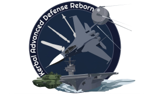

  

  <!-- Discord -->
  
  
  <!-- CKAN Downloads (已改为 HTML img 语法) -->
  

  <!-- License -->
  

  <!-- Stars -->
  

  <!-- Last Commit -->
  

  <!-- Commits since latest -->
  

# Kerbal Advanced Defense Reborn (KADR)

## A collection of realistic Weapons for BDArmory Plus

| |
| :---: |
|  |

| | |
| :---: | :---: |
|  |  |

## Dependencies

- [BDArmory Plus](https://forum.kerbalspaceprogram.com/topic/209092-19x-112x-bdarmory-plus-bda-v1710-2024-09-04/)

## Installation

Place the `KerbalAdvancedDefenseReborn` folder into your `GameData` directory.

## Notes

- This is a pre-release. Models and configs are being continuously refined.
- Some missiles require radar or targeting pod equipment on the launch craft (SARH, laser-guided types).
- Feedback and contributions are welcome!
- [查看目前进度|Current Progress](Plan.markdown)

## Localization

- English (en-us)
- 简体中文 (zh-cn)

## Current Arsenal

### Surface-to-Air
| 9M33M3 Osa | 9M38M1 | Type81 Tan-Sam | IRIS-T SLM | IRIS-T SLS | Rapier MK1 | Rapier Mk1E | Rapier Mk2 |
|---|---|---|---|---|---|---|---|
| FIM-92K | MIM-104E Patriot (PAC-2) | S-300PS 5V55R | RIM-8A | RIM-24A | RIM-24B | RIM-24C | RIM-2C |
| 9M37M | RIM-2E |  |  |  |  |  |  |
|  |  |  |  |  |  |  |  |

### Surface-to-Surface
|  |  |  |  |  |  |  |  |
|---|---|---|---|---|---|---|---|
|  |  |  |  |  |  |  |  |

### Anti-Ship
| P-35 | YJ-8 | YJ-81 |  |  |  |  |  |
|---|---|---|---|---|---|---|---|
|  |  |  |  |  |  |  |  |

### Air-to-Ground
| Anti-Radiation | CM-102 | KH-58U |  |  |  |  |  |
|---|---|---|---|---|---|---|---|
|  |  |  |  |  |  |  |  |
| AGM |  |  |  |  |  |  |  |
|  |  |  |  |  |  |  |  |
| Laser Guided Bomb | | | | | | | |
| | | | | | | | |
| Glide bomb | | | | | | | |
| | | | | | | | |
| Unguided Bomb | | | | | | | |
| | | | | | | | |

### Air-to-Air
| IR (Fox2) | PL-5EII | Red Top | R-3S | R-60MK | R-60K | R-23T |  |
|---|---|---|---|---|---|---|---|
| | R-40T | AIM-9B | R-24T | R-24TM | | | |
| | R-40TD | | | | | | |
| SARH (Fox1) | AIM-7A | AIM-7C | AIM-7D | AIM-7E | AIM-7E2 | AIM-7F | AIM-7M |
| | R-3R | R-40R | R-40RD | AIM-26B | R-23R | R-24R | R-24RM |
| | Super 530D | | | | | | |
| ARG (Fox3) | PL-15 |  | | | | | |
| | AIM-7B | | | | | | |
| | | | | | | | |

### Wunderwaffe
| Nuclear Bomb | B-28FI | B-61 | MK-8 | B-41 | RN-28 | B-53 |  |
|---|---|---|---|---|---|---|---|
|  | Tsar Bomba |  | | | | | |
| Nuclear Warhead | W88 | | | | | | |
|  |  |  |  |  |  |  |  |
| Nuclear Missile | AIM-26A | RIM-8B | 3M44 | RIM-2D |  |  |  |
|  |  |  |  |  |  |  |  |

### Radars
| RP-31M | RP-31 | RP-25M | RP-25 | RP-21M | RP-22SM | | |
|---|---|---|---|---|---|---|---|
| RP-23D-III | RP-23MLA-II | RP-23ML |  |  |  |  |  |
|  |  |  |  |  |  |  |  |

### IRST
| 8TK/8TP | TP-26Sh-1 | TP-26 | TP-23 | | | | |
|---|---|---|---|---|---|---|---|
| | | | | | | | |

### Missile Launchers
| B-187/189 |  |  |  | | | | |
|---|---|---|---|---|---|---|---|
|  | | | | | | | |
